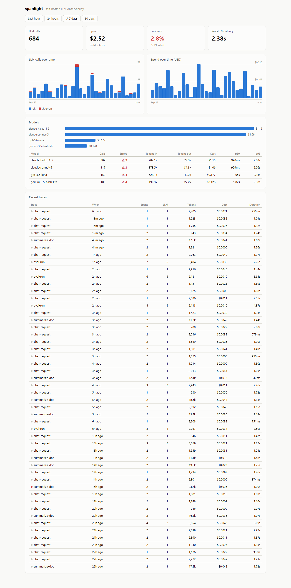
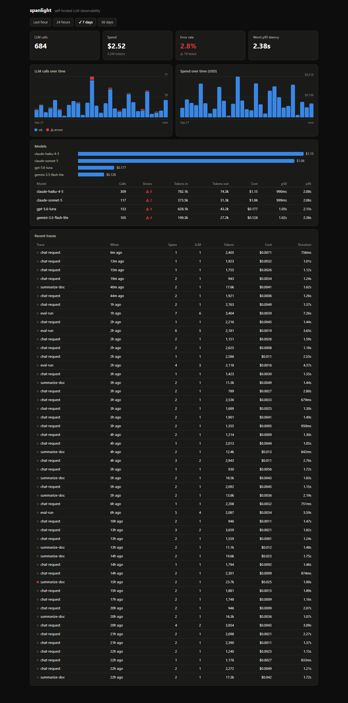
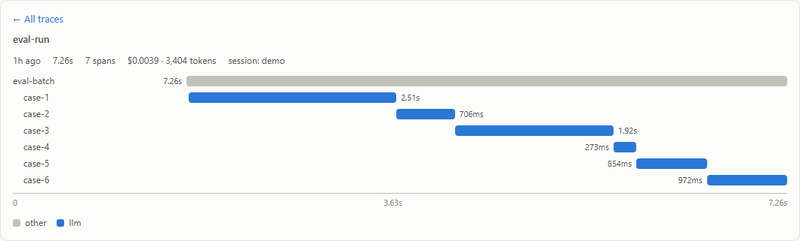
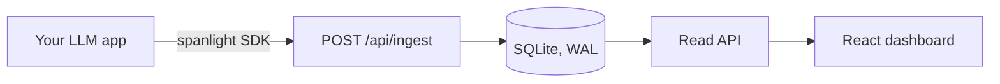

# spanlight

[](https://github.com/Antheagao/spanlight/actions/workflows/ci.yml)

Self-hosted LLM observability: traces, spans, token and cost accounting, and latency stats for LLM applications.
One small server, one dashboard, zero vendor accounts.

Tools like Langfuse and LangSmith do this well as hosted products.
spanlight exists for the cases where your prompts and completions should not leave your machine: it is a single `pip install`, backed by SQLite, with no API keys, no sign-up, and no data egress.



<details>
<summary>Dark mode and the span waterfall</summary>




</details>

## What you get

- **Tracing**: group the work behind one request (LLM calls, retrieval, tool use) into a trace of timed spans.
- **Cost and token accounting**: every LLM span carries input/output tokens and cost; the API aggregates both per trace and per model.
- **Latency stats**: p50/p95 latency and error rates per model.
- **Timeseries**: calls, tokens, cost, and errors over time, bucketed for charting.
- **A local dashboard**: stat tiles, calls and spend over time, per-model stats, a trace list, and a span waterfall with payload inspection - light and dark, colorblind-validated palette.

## Quickstart

```bash
pip install -e ".[server]"
python -m spanlight.demo     # optional: seed a week of demo traffic, no keys needed
python -m spanlight.server   # serves on http://127.0.0.1:4318
```

Instrument your app (the SDK is stdlib-only; `pip install spanlight` adds zero dependencies):

```python
from spanlight import Spanlight

sl = Spanlight()  # buffers in-process, flushes in the background
with sl.trace("chat-request", user="demo") as t:
    with t.llm_span("answer", model="claude-haiku-4-5") as s:
        reply = call_model(prompt)
        s.record_usage(input_tokens=420, output_tokens=180,
                       input_text=prompt, output_text=reply)
```

Cost is computed from a bundled list-price table (override with `Spanlight(prices={...})`); unknown models record `None` rather than a guess.
A span that raises records `status="error"` and re-raises; if the collector is down, traces drop with one warning - the SDK never takes your app down.

Or send a trace by hand:

```bash
curl -s -X POST http://127.0.0.1:4318/api/ingest -H 'content-type: application/json' -d '{
  "traces": [{"id": "t1", "name": "chat-request", "started_at": 1700000000.0, "ended_at": 1700000001.6}],
  "spans": [{"id": "s1", "trace_id": "t1", "name": "llm:haiku", "kind": "llm",
             "started_at": 1700000000.1, "ended_at": 1700000001.5,
             "model": "haiku", "input_tokens": 420, "output_tokens": 180, "cost_usd": 0.0011}]
}'
```

Read it back:

```bash
curl -s http://127.0.0.1:4318/api/traces          # newest-first summaries with aggregates
curl -s http://127.0.0.1:4318/api/traces/t1       # full span tree
curl -s http://127.0.0.1:4318/api/stats/models    # per-model tokens, cost, p50/p95 latency
```

## API

| Endpoint | Purpose |
|---|---|
| `POST /api/ingest` | Batch-upsert traces and spans (the SDK reports a trace at open and again at close). |
| `GET /api/traces?limit&before&before_id&q` | Newest-first trace summaries with span/token/cost aggregates. Cursor-paged: pass the response's `next_before` and `next_before_id` back (`before` alone skips ties on `started_at`). |
| `GET /api/traces/{id}` | One trace with its spans in order. |
| `GET /api/stats/models?since` | Per-model calls, errors, tokens, cost, p50/p95 latency. |
| `GET /api/stats/timeseries?since&bucket_seconds` | Calls, tokens, cost, errors over time. |
| `POST /v1/traces` | OTLP/HTTP trace ingest (protobuf or JSON, optional gzip). See below. |
| `GET /healthz` | Database round-trip check. |

Errors under `/api` have one shape: `{"error": {"code": "invalid_body", "message": "...", "field": "spans[0].kind"}}`.
`code` is stable and meant to be branched on, and `field` appears only when one input is at fault.
Validation failures are `400 invalid_body`, an unknown route is `404 not_found`, and a busy database is `503 database_busy` with `Retry-After`.

## Security model

spanlight is a dev-tools daemon for localhost or a private network, not a multi-tenant service.
It binds to `127.0.0.1` by default and has no login.
The checks below still apply on every request, because a page open in your browser can reach a loopback server.

- **Host allowlist.** Every request, including the dashboard, must name `localhost`, `127.0.0.1` or `[::1]` in its `Host` header, with any port.
  This stops DNS rebinding from reading your stored prompts.
  Add names with `SPANLIGHT_ALLOWED_HOSTS` (comma separated), for example `host.docker.internal` when an app in a container sends traces.
  `GET /healthz` is exempt, because it reveals nothing and probes often use a container or pod IP as the host.
- **Writes.** `POST`, `PUT`, `PATCH` and `DELETE` are refused with `403` when their `Origin` is not the request's own host and port.
  A request that carries a body is refused with `415` unless its content type is `application/json` or `application/x-protobuf`.
  A browser form or `text/plain` request needs no CORS preflight, so refusing those types is what keeps other sites from writing.
  Behind a TLS proxy, uvicorn must be told to trust it (`FORWARDED_ALLOW_IPS=<proxy ip>`), so it reports `https` and a default-port `Origin` matches the `Host`.
  To let a page on another origin call the API (CORS and writes), list it in `SPANLIGHT_DEV_ORIGINS`, comma separated.
  It is empty by default, because trusting an origin trusts every program on this machine that can serve it.
- **Ingest token.** Set `SPANLIGHT_INGEST_TOKEN` (at least 32 printable characters, no whitespace) and every write must send `Authorization: Bearer <token>`.
  The SDK reads the same variable, or takes `Spanlight(token=...)`.
  Reads stay open, because the dashboard has no login.
- **Local readers.** With no token on loopback, any process or user on this machine can read stored prompts and completions over HTTP.
  The database file is created with mode `0600`, so the file itself is private to your user, and the server warns at startup if an existing file is group or world readable.
- **Network binds.** Setting `SPANLIGHT_HOST` to anything other than a loopback address requires a token, and the server refuses to start without one.
  Binding beyond loopback also exposes reads to that network, so put it behind your own access control.
- **Limits.** Request bodies are capped at 16 MiB (`SPANLIGHT_MAX_REQUEST_BYTES`), counted as they arrive, and refused with `413` before anything is parsed.
  At most 64 connections are served at once (`SPANLIGHT_MAX_CONCURRENCY`), and the next gets a plain `503` from the server.
- **Headers.** Every response carries a strict `Content-Security-Policy`, `X-Content-Type-Options: nosniff`, `Referrer-Policy: no-referrer` and `Cross-Origin-Resource-Policy: same-origin`.
  The interactive API docs and the OpenAPI schema are not served.

Configuration is read once at startup, and a malformed value stops the server with a message naming the variable.

## OpenTelemetry ingest

spanlight accepts OTLP/HTTP traces, so any OpenTelemetry SDK or collector can send to it, with no spanlight SDK.
Point the exporter at the server (the default port is the standard OTLP/HTTP port):

```bash
export OTEL_EXPORTER_OTLP_ENDPOINT=http://127.0.0.1:4318
export OTEL_EXPORTER_OTLP_PROTOCOL=http/protobuf   # or http/json
```

`POST /v1/traces` takes `application/x-protobuf` or `application/json`, optionally gzip or deflate compressed, and answers in the request's encoding.
Spans that cannot be stored (a trace or span id of the wrong length or all zeros, no start time) are reported in `partial_success.rejected_spans`, and the rest are stored.
Errors are `google.rpc.Status` bodies, and a busy database is a `503` with `Retry-After`, which exporters retry.
Metrics and logs are refused with a `404`.
The ingest token, the size cap and the Host and Origin checks apply to this route like any other write.

How a span is mapped:

- **Traces are derived.**
  OTLP sends spans, never traces, and a trace's spans arrive in any order and any batch.
  A trace's name, status, time window, session and root span are recomputed from its stored spans, so arrival order does not matter and resending a batch changes nothing.
  The name and status come from the root span (the earliest span with no parent); the session is the `session.id` or `gen_ai.conversation.id` attribute.
- **Kinds** come from `gen_ai.operation.name`: `chat`, `text_completion` and `generate_content` are `llm`, `execute_tool` is `tool`, `retrieval` is `retrieval`, and everything else is `other`.
- **Only `llm` spans fill the model, token and cost columns.**
  Instrumentation often puts a rolled-up cost on a parent span such as `invoke_agent`, and counting it too would double the trace's cost.
  The model is `gen_ai.response.model`, else `gen_ai.request.model`; tokens are `gen_ai.usage.input_tokens` and `output_tokens`.
- **Cost** is the first valid number among the span attributes named in `SPANLIGHT_COST_ATTRIBUTES` (default `spanlight.cost_usd,docpilot.cost_usd`), because the application knows its cache and batch pricing.
  Otherwise it is estimated from the bundled price table, and otherwise it is unknown.
  The source is kept in the span's `otel.cost_source`.
- **Errors**: an `ERROR` status makes the span an error, with its status message or, failing that, the last `exception` event.
- **Message content** is stored only if the instrumentation sends `gen_ai.input.messages` or `gen_ai.output.messages`.
- **Everything else** is kept: all attributes, `events`, `links`, the service name, and an `otel` object with the span kind, scope, resource and dropped counts.
- Over 128 attributes, events or links per span are dropped and counted, strings are cut at 32 KiB, and values JSON cannot hold (`NaN`, integers beyond 2^53) are stored as strings.

## Architecture



SQLite is deliberate: a self-hosted, single-team tool should install in seconds and keep its data in one file.
The server opens one connection behind a lock, so every ingest batch is its own transaction and commits atomically.
Another process writing the same file (the demo seeder, for example) is waited for up to five seconds; past that the API answers `503` with `Retry-After`.
The schema is versioned with `PRAGMA user_version`, and migrations run when the server opens the database.
Before upgrading a non-empty database, spanlight copies it (mode `0600`) to `<db>.v<N>.bak`, where N is the schema version it found.
An existing backup is never overwritten, so a partly failed upgrade keeps the original copy.
A span is identified by `(trace_id, id)` ([ADR 0001](docs/adr/0001-trace-scoped-span-identity.md)).

## Dashboard

```bash
cd dashboard && npm install && npm run build   # the server serves dashboard/dist at /
```

Open http://127.0.0.1:4318/ with the server running.
For dashboard development, `npm run dev` serves it on :5173 with API calls proxied to :4318.
The dashboard only reads, so nothing else is needed.
The dev proxy rewrites the `Host` header, so a dev page that writes through it also needs `SPANLIGHT_DEV_ORIGINS=http://localhost:5173` on the server.

## Development

```bash
pip install -e ".[server,dev]"
pytest          # API + SDK tests over a temp database
HYPOTHESIS_PROFILE=deep pytest tests/test_otlp_decode.py   # fuzz the OTLP decoder harder
ruff check .
```

## Roadmap

- [x] Server: ingest + traces + model stats + timeseries (tested, CI)
- [x] Python SDK: trace/span context managers, cost table, buffered background flush
- [x] React dashboard: stat tiles, calls/spend over time, model stats, trace list, span waterfall
- [x] Demo seeder so the dashboard renders without any LLM keys
- [x] OpenTelemetry ingest: OTLP/HTTP traces from any OpenTelemetry SDK
- [ ] OpenTelemetry bridge: mirror spans to any OTLP collector

## License

MIT
